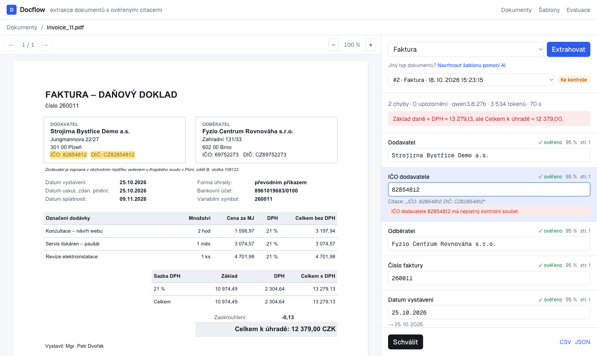

# Docflow

Vytěžování dat z firemních dokumentů lokálním LLM, s ověřením každé hodnoty proti PDF
a deterministickou kontrolou pravidel. Faktury, smlouvy, pojistky nebo jakýkoli jiný typ
dokumentu: obor určuje jen **šablona**, kterou lze vytvořit v UI nebo nechat navrhnout
modelem.

**První placený pilot:** nájemní smlouvy → evidence v Excelu pro správce nájmů.
Připravené funkce, nabídka, podmínky, provoz a měření jsou v [docs/pilot/](docs/pilot/README.md),
obory, ceník a cesta k zákazníkům v [docs/strategie.md](docs/strategie.md).
Nová nájemní šablona zatím nemá změřenou přesnost na reálných smlouvách; veřejná
ukázka obsahuje jeden další fiktivní nájem mimo níže uváděnou evaluační sadu.

**Živě:** https://docflow.logicflow.cz (původní adresa https://docflow-inky-ten.vercel.app také funguje). Bez přístupového kódu ukazuje předpočítané
výsledky na fiktivních dokumentech (rychle, bez nákladů). S kódem se přepne na ostrý
provoz: nahrání vlastního PDF, OCR, extrakce, ruční kontrola a šablony nad skutečným
backendem.

**Vyzkoušet bez kódu:** [/vyzkouset](https://docflow.logicflow.cz/vyzkouset) – vlastní
anonymizovaná faktura, nájemní smlouva nebo objednávka přepravy / CMR (do 10 stran, 3 dokumenty
za 24 h z jedné IP), výsledek s citacemi a pravidly, stažení XLSX a JSON. Data se ukládají
odděleně a mažou do 24 hodin; nepoužívají se k evaluaci. Odkaz s `?ref=<kód>` ukáže v
`scripts/api_keys.py trials`, který oslovený to zkusil.

**Aplikace pro firmy:** každá firma má vlastní pracovní prostor s přístupovým kódem,
vlastními dokumenty, šablonami, měřením a volitelnou denní kvótou; ostatní prostory nevidí.
Správa: `uv run python scripts/workspaces.py create "Firma s.r.o." [--quota 50]`, `list`
(dokumenty a volání modelu za měsíc, podklad k fakturaci), `revoke <id>`. `ACCESS_CODE`
otevírá výchozí prostor s daty z doby před prostory.

**Příjem e-mailem:** firma posílá nebo přeposílá PDF na vlastní adresu
`dokumenty+<kód>@…` (jedna IMAP schránka, proměnné `INTAKE_*`). Přílohy se uloží do jejího
prostoru a s nastavenou šablonou se rovnou vytěží, takže čekají v aplikaci ke kontrole.
Zapnutí: `scripts/workspaces.py intake <id> --template invoice [--senders @firma.cz]`,
přijaté e-maily: `scripts/workspaces.py inbox <id>`.

**API pro integrátory:** `/v1` s klíčem pro každého klienta (`Authorization: Bearer`), denní
kvótou a exportem do XLSX, JSON, POHODY a Money S3. Klíč může patřit pracovnímu prostoru
firmy (`api_keys.py create … --workspace <id>`): pak nabízí i její šablony a čerpá její kvótu.
Podepsané webhooky po dokončení extrakce: `api_keys.py webhook <id> <https-url>`, doručení
`api_keys.py deliveries <id>`. Dokumentace česky na
[/api](https://docflow.logicflow.cz/api), OpenAPI na `<backend>/v1/docs`.



## Proč to není „chat s PDF“

| Problém LLM extrakce | Co s tím dělá Docflow |
|---|---|
| Model si hodnotu vymyslí | U každého pole musí vrátit stranu a doslovnou citaci; kód ověří, že citace v PDF opravdu je a hodnotu obsahuje. Neověřená pole UI označí. |
| Model nepočítá spolehlivě | Model nic nepočítá. Součty, kontrolní součet IČO a pořadí dat ověřuje deterministický kód podle pravidel šablony. |
| Čísla a data v různých formátech | Normalizace v kódu: `12 100,00 Kč`, `1.234,56`, `185 000,- Kč`, `3. 9. 2026`, `1. října 2026`, ISO. |
| Lokální model nepodporuje strukturovaný výstup | Vynucené volání nástroje; když parser Ollamy selže, záložní raw dokončení mimo parser; validace Pydanticem a opakování s chybou jako zpětnou vazbou. |
| Nevíme, jak dobře to funguje | Evaluační sada 37 fiktivních dokumentů včetně těžkých případů, skenů a vložených chyb; přesnost po polích, záchyt chyb, užitečnost signálů v UI, verze promptu. |
| Člověk musí mít poslední slovo | Ruční kontrola v UI: opravy se uloží, pravidla se přepočítají; schválené extrakce lze použít jako další trénovací/evaluační data. |

## Výsledky evaluace

33 fiktivních dokumentů (12 + 4 faktury, 10 smluv, 7 pojistek; 7 z nich jsou „těžké
případy“), 339 polí, 11 vložených chyb. Mac s 32 GB RAM, Ollama.

| Model | Prompt | Přesnost polí | Standardní / těžké | Dokumenty bez chyby | Vložené chyby zachyceny | Medián času |
|---|---|---|---|---|---|---|
| qwen3.8:27b | v1 | 99,1 % | 100 % / 95,9 % | 31 / 33 | 11 / 11 | 102 s |
| qwen3.6:35b-a3b (MoE) | v1 | 99,1 % | 99,6 % / 97,3 % | 30 / 33 | 11 / 11 | 24 s |
| qwen3.8:27b | **v2** | 99,7 % | 100 % / 98,6 % | 32 / 33 | 11 / 11 | 69 s |
| qwen3.6:35b-a3b (MoE) | **v2** | **99,7 %** | 99,6 % / **100 %** | 32 / 33 | 11 / 11 | **23 s** |

Co z evaluace vzešlo:

- **Parser Ollamy selhal u 2 z 26 dokumentů** (model vygeneroval rozbité XML volání
  nástroje, HTTP 500). Oprava: záložní raw dokončení přes `/api/generate`, které parser
  obchází. Ověřeno vynuceným selháním.
- **Těžké případy odhalily dva typy chyb:** model doplnil datum splatnosti u „splatné
  ihned“ (vzal datum vystavení) a dopočítal konec smlouvy z „12 měsíců“. Prompt v2
  zakazuje přebírat hodnotu jiného pole i odvozovat chybějící hodnoty. U qwen3.6 to chyby
  odstranilo, qwen3.8 dál doplňuje splatnost.
- **Chyba normalizace, ne modelu:** u pojistky model správně opsal „1. 10. 2026, 0:00 hod.“,
  ale parser data čas nezvládl. Opraveno v kódu.
- **Pravidla hlídají i model:** jediná zbývající chyba qwen3.6 (základ daně zaměněný za
  celkovou částku) má platnou citaci, takže ji ověření citací nezachytí. Zachytí ji ale
  pravidlo součtu a dokument jde ke kontrole.
- **Jistota modelu sama nestačí:** ze tří chyb qwen3.6 (v1) měla nízkou jistotu jen jedna
  (dopočítaný konec smlouvy, který zároveň neprošel ověřením citace); další dvě měly jistotu
  0,9 a 1,0. Proto Docflow kombinuje tři nezávislé kontroly: citaci, jistotu a pravidla.
- **Překlep v citaci není chyba hodnoty:** model občas citaci zkomolí („ODBĚRATEEL“), i když
  hodnotu opíše správně. Když citace v PDF není, ověřuje se teď přímo hodnota a ta se pak
  zvýrazní. V demu zůstala neověřená jen 2 pole. Daň za to: jedna z takto ověřených hodnot
  byla špatně (sken `invoice_18`, OCR prohodil částky); dokument ale zachytilo pravidlo součtu.
- **Menší MoE model je pro tuto úlohu lepší volba:** stejná přesnost, 3× rychlejší.

**Skeny (OCR).** Strany bez textové vrstvy čte lokálně Tesseract (`ces`). Sada má navíc
4 „skenované“ dokumenty (obrazové PDF, mírné natočení, šum; 41 polí, 1 vložená chyba).
qwen3.6:35b-a3b na nich má **95,1 %** přesnost polí (39 / 41), 3 / 4 dokumenty bez chyby
a vloženou chybu zachytil. Obě chybná pole (prohozený základ a celková částka u faktury,
kde OCR oddělí popisky od hodnot) zůstala označená jako neověřená, ověřená pole byla
správně všechna. Co k tomu bylo potřeba:

- **Mediánový filtr před OCR:** tečky šumu Tesseract čte jako interpunkci v číslech;
  filtr 3×3 zvedl doslovně přečtené hodnoty z 19 na 36 ze 39.
- **Volnější ověření citací jen na OCR stranách:** nejlepší okno textu s podobností
  ≥ 0,85 místo nejdelšího společného úseku ≥ 0,9 a citace s „…“ po částech. Práh je
  změřený: správné hodnoty mají podobnost ≥ 0,88, hodnoty z jiných dokumentů projdou
  v 3,7 % případů (při 0,8 v 10,6 %).
- **Normalizace:** OCR přečte „3 000 000 Kč“ jako „3.000 000 Kč“; parser to teď bere jako
  oddělovače tisíců.

Omezení: výsledky na skenech stojí na 4 generovaných dokumentech; skutečné skeny (horší
kvalita, razítka, rukopis) budou horší. Sada také nemá skutečně neuspořádaná PDF.

**Skutečné smlouvy (20. 10. 2026).** 17 nájemních smluv a dodatků z veřejného
[Registru smluv](https://smlouvy.gov.cz) od 17 různých úřadů a firem: skeny, vadné OCR
vrstvy, nájem na hodinu, ročně i čtvrtletně, podnájmy, dodatky, 1–11 stran. Správné hodnoty
vyplněné ručním čtením každého PDF, 5 smluv zkontroloval druhý člověk (50 / 55 hodnot
potvrdil, zbytek vedl ke změnám níže). Kde je víc správných zápisů (roční i měsíční
nájemné), platí kterýkoli; u místa bez ulice stačí, když odpověď obsahuje číslo budovy či
pozemku. qwen3.6:35b-a3b:

| Stav | Polí | Přesnost polí | Smlouvy bez chyby | Medián času |
|---|---|---|---|---|
| Výchozí šablona | 11 | 88,8 % (166 / 187) | 4 / 17 | 62 s |
| Po dvou opravách kódu | 11 | 94,1 % (176 / 187) | 8 / 17 | 40 s |
| Nájemné rozdělené na 3 pole, opravené hodnoty | 12 | **95,6 %** (195 / 204) | 10 / 17 | 50 s |

- **Chyba normalizace, ne modelu:** české smlouvy píší tisíce s tečkou („100.000 Kč“,
  „9.300,- Kč/rok“); parser je četl jako desetinná čísla. 8 chybných polí v 6 smlouvách,
  fiktivní sada to neodhalila. Opraveno; na fiktivní sadě beze změny.
- **Vadná textová vrstva skenu** („Najemnl smlouva c.“, bez diakritiky): strana se teď čte
  OCR, pokud má méně než 2 % písmen s diakritikou (český text 9–19 %).
- **Nejasná šablona, ne model:** ani člověk při kontrole nevěděl, jestli „nájemné“ zahrnuje
  služby. Šablona má teď tři pole: nájemné, služby a zálohy, celková platba.
- **Zbývá 9 chyb:** služby a celkové platby v příloze dlouhé smlouvy nenalezeny (3×), nájemné
  zaměněné za celkovou platbu (1×), kauce přičtená k celkové platbě (1×), adresa sídla
  nájemce místo předmětu nájmu (1×), chybějící popis místa (1×), období platby (2×).
  Částky a adresy tedy dál musí zkontrolovat člověk.
- Smlouvy obsahují jména skutečných osob, proto PDF ani správné hodnoty nejsou v repozitáři
  (`backend/dataset_real/`, `backend/evals_real/` v `.gitignore`). Spuštění:
  `uv run python scripts/evaluate.py --dataset dataset_real --out evals_real`.

Celý report včetně chybně vytěžených polí je v [backend/evals/](backend/evals/) a na
stránce **Evaluace** v aplikaci.

## Architektura

```
PDF ─► text po stranách (pypdf; skeny lokální OCR Tesseract)
    ─► LLM: pro každé pole šablony {hodnota, strana, citace, jistota}
         Ollama (qwen3.6:35b-a3b, lokálně) nebo OpenAI (strukturovaný výstup)
    ─► ověření citací v PDF ─► normalizace CZ čísel a dat ─► pravidla šablony
    ─► výsledek ke kontrole (needs_review / ok) ─► ruční oprava a schválení
```

- **backend/**: FastAPI, SQLModel (SQLite lokálně, Postgres/Supabase přes `DATABASE_URL`),
  extrakce běží na pozadí. [Podrobnosti](backend/README.md)
- **frontend/**: Next.js 16, react-pdf; PDF a pole vedle sebe, editor šablon, stránka
  evaluací. [Podrobnosti](frontend/README.md)
- **backend/dataset/**: generátor realistických fiktivních dokumentů s ground truth.

## Produkční nasazení

```
Vercel (Next.js) ──► Render (FastAPI v Dockeru, Tesseract) ──► OpenRouter: qwen/qwen3.6-35b-a3b
                                   │
                                   └──► Supabase Postgres (schéma docflow: dokumenty, PDF, extrakce)
```

- **Model:** stejný Qwen, který lokálně vyšel v evaluaci nejlépe, hostovaný přes OpenRouter
  (≈ 0,03 Kč za dokument). Jen poskytovatelé, kteří neukládají ani netrénují na datech
  (`data_collection: deny`), a jen ti se strukturovaným výstupem. Lokálně dál Ollama.
- **Ochrana veřejné adresy:** dokumenty a volání modelu vyžadují přístupový kód
  pracovního prostoru (`X-Access-Code`), globální denní limit volání modelu
  (`DAILY_LLM_LIMIT`) a volitelná kvóta prostoru.
- **Úložiště:** PDF v Postgresu (disk na Renderu se při nasazení maže), extrakce běží na
  pozadí a přežije zavření stránky.
- Konfigurace: [render.yaml](render.yaml), tajné hodnoty jen v dashboardu Renderu.

## Spuštění

```bash
ollama pull qwen3.6:35b-a3b
cd backend && uv sync && cp .env.example .env && uv run uvicorn app.main:app --reload
cd frontend && npm install && npm run dev      # http://localhost:3000
```

Testy: `cd backend && uv run pytest` (bez modelu, s falešným extraktorem),
`cd frontend && npm run lint && npx tsc --noEmit`.
Evaluace: `cd backend && uv run python scripts/evaluate.py [--model …] [--limit N]`.

Všechny dokumenty v repozitáři jsou fiktivní.
