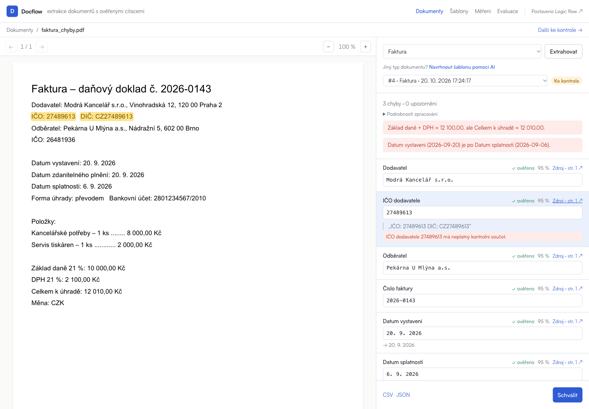

# Docflow — funkční a UX audit, 20. 10. 2026

> Doporučení z tohoto auditu byla následně zapracována. Aktuální stav, ověření a srovnání modelů jsou v [navazujícím reportu](2026-10-20-followup.md). Níže je zachovaný původní stav auditu.

## Výsledek

Hlavní pracovní postup funguje: nahrání PDF → výběr šablony → extrakce → kontrola zdroje → oprava → schválení → export. Otestován byl skutečný lokální model, samostatné dokumenty i dokončená dávka. Nalezené chyby níže jsou opravené v pracovním stromu.

Největší zbývající slabinou je proměnlivá doba lokální extrakce. UI je po úpravách přehlednější, ale editor šablon a dlouhé seznamy si zaslouží další samostatné zjednodušení.

## Prostředí a hranice ověření

- Lokální Next.js na portu 3000, produkční sestavení veřejného dema na portu 3001.
- FastAPI na portu 8000, oddělená SQLite databáze `/tmp/docflow-qa-20261020.db`. Testy nepoužívaly provozní databázi.
- Skutečné extrakce přes lokální Ollamu, `qwen3.8:27b`; pouze fiktivní dokumenty z repozitáře.
- Prohlížeč ovládaný Playwrightem; šířky 320, 390, 768 a 1440 px.
- Produkční infrastruktura, skutečný produkční přístupový kód, Safari/Firefox, zátěž více uživateli a skutečné soukromé dokumenty nebyly součástí ověření. Změny nejsou nasazené.
- Přechod z AI návrhu do editoru a návrat do dokumentu byly ověřeny se simulovanou odpovědí modelu. Samotné generování návrhu novou skutečnou inferencí se v tomto auditu nespouštělo; backend má pro tento endpoint existující automatické testy.

## Ověřené scénáře

| Oblast | Ověření | Výsledek |
|---|---|---|
| Veřejné demo | Všech 38 dokumentů, načtení PDF a polí | Prošlo, bez zachycených pádů JavaScriptu |
| Skupiny ukázek | Faktury, smlouvy, pojistky, nájmy; šipky na klávesnici | Prošlo |
| PDF | Změna strany kliknutím na zdroj, zvýraznění citace, zoom | Prošlo |
| Samostatná faktura | Skutečná extrakce, změna hodnoty, schválení | Prošlo |
| Nájemní smlouva | Upload, skutečná extrakce 12 polí, zdroj na druhé straně, schválení | Prošlo |
| Dávka | Upload dvou faktur, automatický předvýběr faktury, dokončení na pozadí, obnovení stavů v seznamu | Prošlo |
| Vložené chyby | Neplatné IČO, nesoulad součtu, obrácené pořadí dat | Všechny tři zachyceny |
| OCR | Upload obrazového `invoice_18.pdf`, načtení náhledu, OCR označení a možnost extrakce | Prošlo; nová inference nad tímto skenem nebyla spouštěna |
| Exporty | Stažení CSV a JSON z detailu, XLSX schválené faktury, CSV měření | Prošlo |
| Ochrany exportu | Neschválené výsledky; společný export faktury a nájmu | Správně odmítnuto s vysvětlením |
| Šablony | Kopie, vytvoření, přejmenování klíče používaného pravidlem, uložení, nové načtení, smazání | Prošlo |
| Opakované kopírování | Faktura → kopie; smlouva → další kopie; nový prázdný formulář | Správný samostatný návrh při každém otevření |
| Validace | Prázdná šablona, neplatný PDF soubor, smazání pole používaného pravidlem | Srozumitelné chyby |
| Měření | Zobrazení schválených dokumentů, filtr šablony, zadání ručního času, export | Prošlo |
| Evaluace | Přepnutí všech 6 běhů klávesnicí | Prošlo |
| Chybové adresy | Neexistující ID, neplatné ID, návrat ze stránky 404 | Prošlo |
| Mobil a tablet | Domovská stránka, šablony, detail šablony, měření, evaluace, detail dokumentu ve čtyřech šířkách | Bez přesahu celé stránky do strany po dokončení načítání |
| Demo oprávnění | Pole pouze pro čtení, žádné nefunkční schvalování nebo vytváření šablon, zavření formuláře přístupového kódu | Prošlo |

## Opravené problémy

1. **Záměna návrhů šablon při opakované navigaci.** Next.js zachovával stav editoru; kopie smlouvy mohla otevřít dřívější kopii faktury. Každé nové otevření teď dostane vlastní identitu návrhu.
2. **Zablokování dokumentu po AI návrhu.** Po návratu z editoru mohl zůstat stav „model navrhuje šablonu“ a neaktivní akce. Stav se uklízí při dokončení i skrytí stránky.
3. **Rozbité vazby pravidel po přejmenování klíče.** Odkazy v pravidlech se aktualizují spolu s klíčem. Smazání používaného pole vyžaduje nejdřív úpravu pravidla.
4. **Nevhodný výchozí typ dávky.** I dvě zjevné faktury měly předvolenou smlouvu. Výběr teď používá stejnou nápovědu podle názvu souboru jako detail; při různých odhadech vyžaduje výběr uživatele.
5. **Zastaralé demo nájmu.** Veřejná ukázka měla 11 polí oproti aktuálním 12. Ukázka nyní obsahuje skutečný nový výsledek včetně celkové platby, se skutečným modelem a časem zpracování. Generátor rozpozná změnu šablony; režim `--regrade` nespustí model kvůli změně zadání bez výslovného přegenerování.
6. **Nefunkční akce ve veřejném demu.** Editace, schválení, kopírování a vytvoření šablony už nevedou uživatele do slepé uličky s odmítnutým uložením.
7. **Mobilní přesahy.** Navigace, přepínač ukázek, názvy dokumentů a obsah evaluace se vejdou i na 320 px. Široké tabulky zůstávají posuvné uvnitř svého panelu.
8. **Klávesnice a orientace.** Navigace označuje aktivní stránku, záložky podporují šipky/Home/End, běhy evaluace mají skutečná tlačítka, zdroje mají pojmenované ovládací prvky.
9. **Přebytek technických údajů.** Model a tokeny v detailu i příkaz ke spuštění evaluace jsou dostupné až po rozbalení. Domovská stránka má kratší rozestupy mezi sekcemi.
10. **Konzistence UI.** Velikosti textu jsou napojené na dodané tokeny; schválení je vpravo dole a při existujícím výsledku je opakovaná extrakce vedlejší akce. UI respektuje omezení animací.
11. **Chybová komunikace.** Běžné chyby uploadu a chybějící záznamy mají české zprávy; 404 je česky s návratem do aplikace. Prázdná či nesprávně vyplněná šablona má validaci před odesláním.
12. **Další stavy.** Starší odpověď měření už nepřepíše nový filtr; již schválený nezměněný výsledek nejde znovu schválit náhodným kliknutím; formulář přístupového kódu lze zavřít. Stav běžící extrakce vysvětluje i čekání ve frontě.

## Automatické kontroly

- `backend: uv run pytest` — **129 prošlo**, z toho 2 nové regresní testy zastarání demo šablony.
- `backend: uv run ruff check scripts/export_demo.py tests/test_demo_export.py` — prošlo.
- `frontend: npm run lint` — prošlo.
- `frontend: npx tsc --noEmit` — prošlo při průběžné kontrole; závěrečný produkční build také zahrnuje kontrolu TypeScriptu.
- `frontend: NEXT_PUBLIC_DEMO=1 npm run build` — prošlo.
- Všechny uložené demo výsledky mají po opravě aktuální snímek své šablony.

## UX posouzení a doporučené pořadí další práce

**P1 — rychlost a průběh zpracování.** Skutečné lokální časy v tomto běhu: přibližně 146 s u faktury, 263 s u nájmu, 380 s a 61 s u faktur v dávce. Jde o jednotlivá pozorování v konkrétním lokálním prostředí, ne o benchmark nebo měření produkce. Před pilotem změřit reprezentativní dávku v cílovém prostředí, porovnat dostupné modely a oddělit v UI čekání od aktivního zpracování. Uvažovat i o bezpečném zrušení čekající úlohy.

**P2 — jednodušší editor šablon.** Dvanáct polí samo o sobě není problém; zahlcují je současně zobrazené klíče a dlouhé pokyny modelu. Nabídnout běžný pohled „název / typ / povinné“ a pokročilé nastavení rozbalovat. Dlouhé pokyny upravovat ve víceřádkovém poli, aby byly čitelné celé.

**P2 — orientace ve větší evidenci.** Doplnit hledání podle názvu, filtr „ke kontrole / schváleno / chyba“ a stránkování. Ruční kontrola má být dostupná přímo z filtrovaného seznamu. Současný seznam funguje, ale s rostoucím objemem bude zbytečně dlouhý.

**P2 — mobilní kontrola zdroje.** Dva panely pod sebou fungují, ale při kontrole více polí musí uživatel přejíždět mezi PDF a formulářem. Zvážit přepínač „PDF / údaje“ nebo otevření zdroje v přehledném mobilním panelu se snadným návratem na stejné pole.

**P3 — běžný uživatel versus technické podklady.** Domovská stránka po úpravách nemá nadbytečný obsah, protože ukázky jsou omezené na šest a technické detaily jsou rozbalovací. Evaluace je stále dlouhá odborná stránka; pro zákazníka dává smysl přesunout ji do sekundární navigace a ponechat hlavní prostor dokumentům a kontrole.

