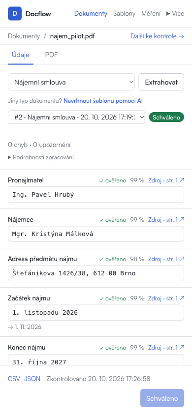

# Zapracování doporučení z auditu — 20. 10. 2026

Navazuje na [původní audit](2026-10-20-audit.md). Všech pět doporučených oblastí bylo posouzeno a níže uvedené změny jsou implementované lokálně.

## Změny a ověření

| Doporučení | Implementace | Ověření |
|---|---|---|
| P1: rychlost | Výchozí lokální model je `qwen3.6:35b-a3b`; aktualizovaná konfigurace, příklad `.env` a návody. Výslovná vlastní konfigurace modelu má dál přednost. | Nové měření obou modelů na stejných třech dokumentech; nový backend skutečně hlásí model `qwen3.6:35b-a3b`. |
| P1: průběh extrakce | Backend ukládá čekání a aktivní zpracování odděleně. Detail průběžně aktualizuje fázi i při stále stejném statusu `running`. Samostatný čas čekání a inference je vidět i v podrobnostech hotového výsledku. | Dva nové backendové testy ověřují stav během samotného volání extraktoru, pořadí dvou dokumentů i selhání. Prohlížeč ověřil přechody při pollingu a skutečnou dávku se dvěma dokumenty. |
| P2: editor šablon | Základní řádek obsahuje název, typ a povinnost pole. Klíč a pokyny pro model jsou pod „Pokročilé nastavení“. Popis dokumentu a pokyny pro pole mají víceřádkové editory. | Klíče jsou po otevření formuláře skryté. Rozbalení, změna klíče používaného pravidlem, víceřádkové pokyny, uložení a nové načtení zachovaly správné hodnoty i pravidlo. |
| P2: evidence | Hledání podle názvu bez závislosti na diakritice, filtry stavů, stránky po 20 záznamech a srozumitelný prázdný výsledek. Hromadný výběr respektuje filtr, přidává k dosavadnímu výběru a má limit 100. Odkaz na další kontrolu vychází z filtrovaných výsledků. | Na 45 testovacích záznamech ověřeny stránky, hledání „najem“ proti „Nájem“, všech pět filtrů, prázdný stav a zachování výběru. Na 105 záznamech ověřen limit 100 a zrušení výběru. Tyto větší seznamy byly simulovanými odpověďmi API, nebyly ukládány do databáze. |
| P2: mobilní zdroje | Na mobilu a tabletu pod 1024 px jsou přepínače „Údaje / PDF“. Kliknutí na zdroj otevře odpovídající stranu PDF; „Zpět k údaji“ vrací fokus ke stejnému poli. Oba panely zůstávají připojené, rozepsané opravy se neztrácejí. | Ověřen přechod ke kauci na straně 2, návrat ke kauci, zachování rozepsaného nájemného i navigace mezi více dokumenty. ID polí a panelů jsou jednoznačná také při zachovaných stránkách Next.js. |
| P3: technické podklady | Evaluace je v sekundární nabídce „Více“; hlavní navigace ponechává dokumenty, šablony a měření. | Otevření evaluace, označení aktivní stránky, zavření klávesou Escape a návrat fokusu. |

Stránkování je zatím na klientovi nad seznamem vráceným API. Omezuje délku stránky a počet vykreslených řádků; není náhradou serverového stránkování pro řádově větší provoz.

## Nové srovnání lokálních modelů

Stejné tři fiktivní textové dokumenty, stejná aktuální šablona pro každý typ a prompt v2. Modely běžely postupně na stejném stroji, nesoutěžily navzájem o prostředky. Čas zahrnuje načtení PDF a extrakci; první dokument může zahrnovat načtení modelu.

| Dokument | qwen3.8:27b | qwen3.6:35b-a3b |
|---|---:|---:|
| `invoice_01.pdf` | 141,6 s | 54,9 s |
| `contract_01.pdf` | 133,5 s | 30,2 s |
| `policy_01.pdf` | 103,9 s | 26,9 s |
| Medián | 133,5 s | 30,2 s |
| Správná pole | 30 / 30 | 30 / 30 |

Na této malé sadě klesl medián přibližně 4,4×. Tři standardní dokumenty neprokazují obecnou přesnost, chování na skenech ani produkční výkon. Volba výchozího modelu se opírá také o dřívější širší evaluaci v repozitáři, kde tato varianta dosáhla stejné přesnosti jako `qwen3.8:27b` a kratšího času. Produkční OpenRouter už stejný model používal; jeho konfigurace se nemění.

Navazující skutečná dávka v aplikaci skončila u obou faktur stavem `ok` a fází `completed`. Zpracování trvalo 102,7 s a 29,0 s; druhý dokument před zahájením čekal 102,8 s. To ověřilo i oddělené měření fronty v reálném provozu a současně ukazuje, že jednotlivé časy nadále kolísají.

Výstupy nového běhu:

- [qwen3.8:27b — měření a chyby](benchmark/20261020-1743-qwen3.8-27b-p2.json), [souhrn](benchmark/20261020-1743-qwen3.8-27b-p2.md)
- [qwen3.6:35b-a3b — měření a chyby](benchmark/20261020-1750-qwen3.6-35b-a3b-p2.json), [souhrn](benchmark/20261020-1750-qwen3.6-35b-a3b-p2.md)

Pro zopakování se použil existující `scripts/evaluate.py`: z `dataset/labels.json` a příslušných PDF byla připravena podsada výše uvedených tří souborů v `/tmp/docflow-audit-benchmark-20261020`. Z adresáře `backend` pak postupně:

```bash
uv run python scripts/evaluate.py --provider ollama --model qwen3.8:27b --dataset /tmp/docflow-audit-benchmark-20261020 --out ../docs/qa/benchmark
uv run python scripts/evaluate.py --provider ollama --model qwen3.6:35b-a3b --dataset /tmp/docflow-audit-benchmark-20261020 --out ../docs/qa/benchmark
```

## Kontroly a hranice

- Backend: **131 testů prošlo**, včetně testů nových fází a jejich časování; Ruff prošel pro změněný aplikační kód a testy.
- Frontend: lint a produkční sestavení s kontrolou TypeScriptu prošly.
- Nové obrazovky byly proklikány při šířkách 320, 390, 768 a 1440 px; bez vodorovného přesahu celé stránky.
- Produkční sestavení veřejného dema zachovalo režim pouze pro čtení a nový mobilní přechod ke zdroji fungoval i v něm.
- Testovalo se v oddělené lokální databázi. Produkční data a nasazení se neměnily.
- Zrušení čekající úlohy původní audit uváděl k zvážení; nebylo přidáno. Provozní zátěžový test a měření na cílovém hostingu zůstávají krokem před skutečným pilotem, nikoli tvrzeným výsledkem tohoto lokálního měření.


